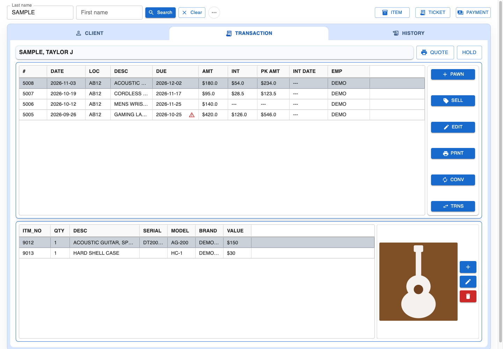
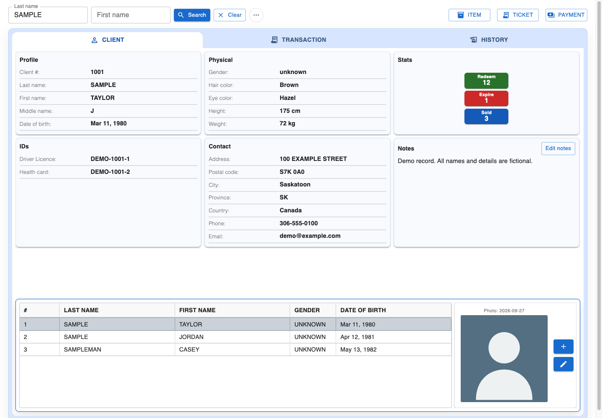
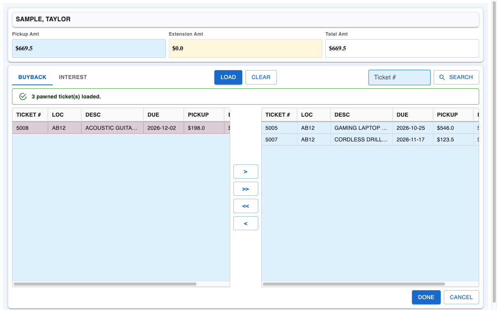
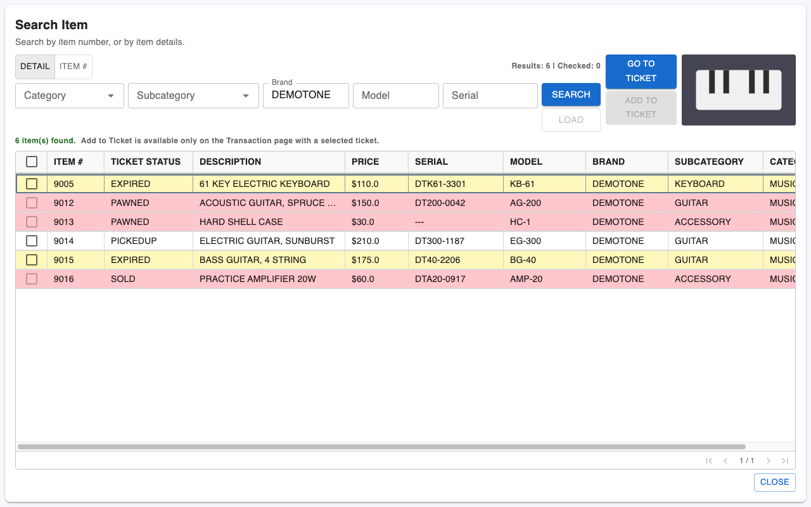

# PawnSystemApp

A full-stack desktop application for running a pawn shop: clients, pawn and sell
tickets, items, payments and reports. Built with React, Electron, NestJS and
PostgreSQL, with tooling to import legacy Microsoft Access data.



| Client profile and search                   | Pickup and interest payments                    |
| ------------------------------------------- | ----------------------------------------------- |
|  |  |

| Item search across tickets                              |
| ------------------------------------------------------- |
|  |

_Screenshots use fictional demo data from a local stub API; photos are placeholders._

## Features

- **Clients:** name and birthday search, profiles, IDs, photos, signed notes, holds
  and activation. Inactive clients cannot receive new tickets.
- **Tickets:** pawn, sell, edit, convert, transfer, expire, mark stolen, reverse and
  repawn, with printable envelope tickets.
- **Payments:** pickups and interest extensions, with a legal pickup hold warning.
- **Items:** search, categories, photos and linking items to new tickets.
- **Reports:** daily, buyback, interest and overdue, plus LeadsOnline XML submission.
- **Administration:** employees, locations, holidays, ID types, colors and item categories.
- **Legacy import:** Access records and photos mapped into PostgreSQL, with backups
  and post-import validation.

## Architecture

```text
React UI ── HTTP ── NestJS controllers → services → repositories → PostgreSQL
    │
    └── preload bridge ── Electron windows, menus, XML reports
```

| Area      | Technology                                                    |
| --------- | ------------------------------------------------------------- |
| Frontend  | React 18, TypeScript, Material UI, MUI Data Grid, Vite        |
| Desktop   | Electron                                                      |
| Backend   | NestJS, class-validator, node-postgres with parameterized SQL |
| Database  | PostgreSQL 16 in Docker                                       |
| Migration | Node.js, mdbtools, versioned JSON mapping rules               |
| Testing   | Vitest for the server; Node test runner for everything else   |

## Engineering highlights

- **The server owns business rules.** The frontend requests and renders; interest,
  legal dates and status changes are decided on the server.
- **Money cannot drift.** Payment requests carry the amounts the screen showed. The
  server recomputes them under row locks and rejects the whole batch with 409 if any differs.
- **Concurrency is designed in.** Multi-step writes run in one transaction, and rows
  lock in a fixed order so parallel requests cannot deadlock or remove the last manager.
- **Photo storage stays private.** Responses carry an `image_url`, never a file path,
  and new files get server-chosen UUID names.
- **Employee PINs are never stored in plain text.** They are stored as a keyed
  HMAC-SHA256, which still allows lookup by PIN alone.
- **Dates do not depend on the host.** Business dates use the `America/Regina` shop
  calendar, tested under other process time zones.
- **630+ automated tests.** HTTP tests run real Nest routes and DTOs against a mocked
  database connection; they do not touch a live database.

## Current status

The business workflows are moving from Electron IPC to the NestJS server.

- Clients, employees, reference data, tickets, items and reports use HTTP.
- XML reports (LeadsOnline) still run in Electron.
- API routes have no authentication yet. Employee PINs attribute actions but do not
  create a login session, so this must stay on a trusted network for now.
- There is no installer or server container yet: the desktop app needs Vite, and
  Docker runs PostgreSQL only.

## Getting started

You need Node.js 22, Docker Desktop and a desktop environment. From the repository root:

```bash
npm ci
npm --prefix server ci
cp .env.example .env
```

Set the database credentials and `EMPLOYEE_PIN_SECRET` (at least 32 characters) in `.env`, then:

```bash
docker compose --env-file .env -f docker/compose.yaml up -d --wait db
npm run db:init
npm run dev
```

This starts Vite on 5173, NestJS on 3000 and Electron; PostgreSQL uses 5432 (Docker, local-only). The server container also uses 3000, so stop it (`docker compose ... stop server`) before running the dev server.
`db:init` does not create an employee. To import Access data instead, see the
[migration guide](database/README.md#access-migration) or the
[Windows setup](docs/instructions.md).

## Verification

```bash
npm run typecheck:main
npm run typecheck:renderer
npm test
npm --prefix server test
npm --prefix server run test:e2e
npm --prefix server run build
npm run build
```

## Documentation

- [Frontend](frontend/README.md)
- [Electron](electron/README.md)
- [Server](server/README.md)
- [Database](database/README.md)
- [Shared code](shared/README.md)

## Private data

Credentials, Access files, client and employee records, photos, migration reports and
backups are ignored by Git. Commit only source code and sanitized example configuration.
